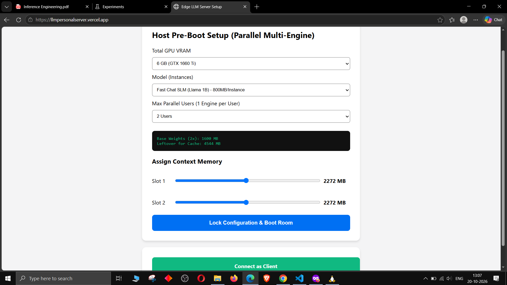
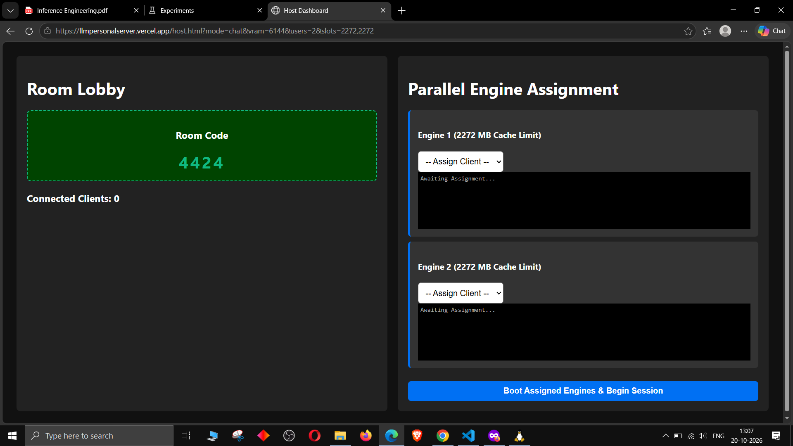
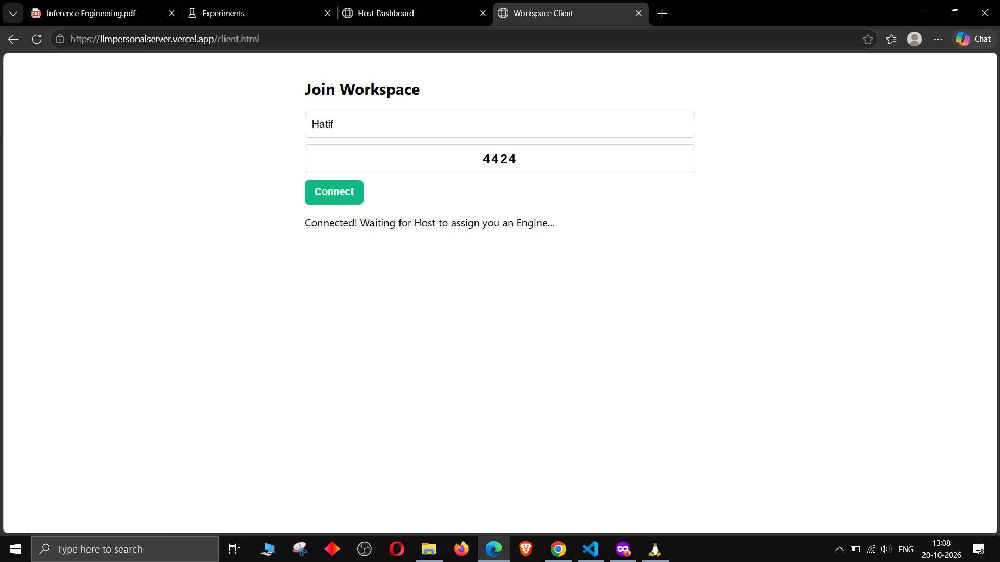
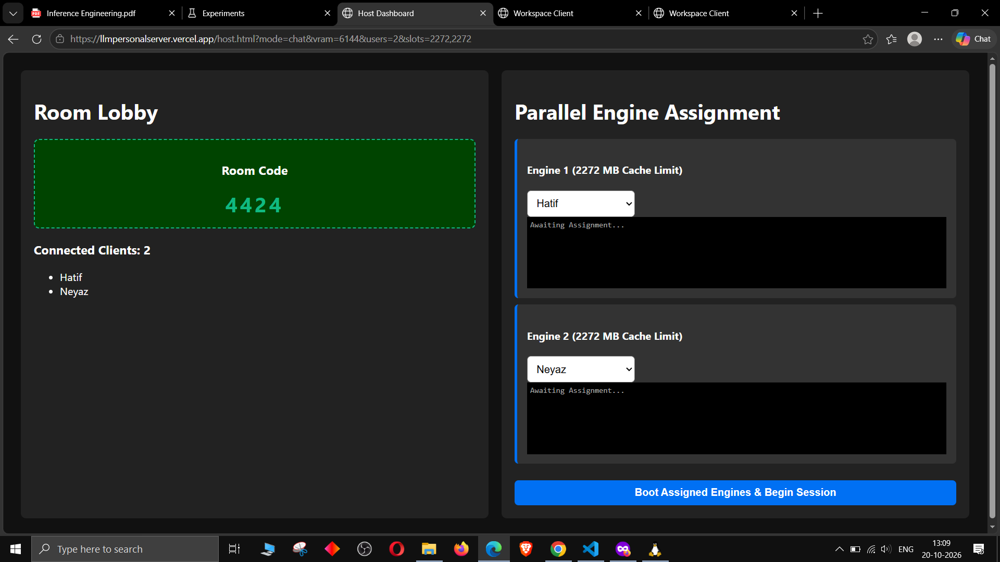
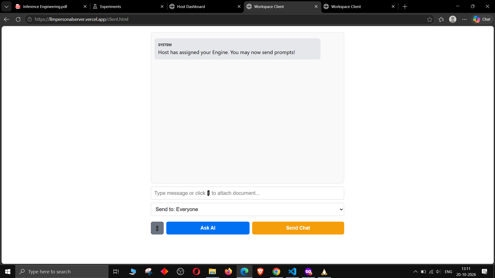
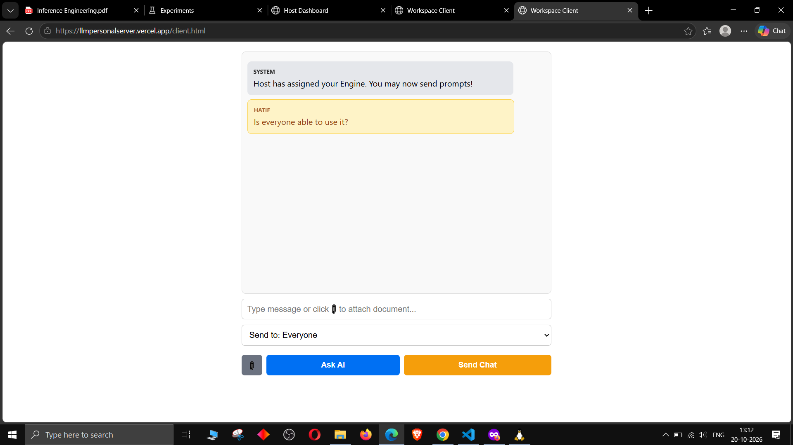

# Edge AI Workspace: P2P Browser-Based LLM Server

[](https://www.youtube.com/watch?v=YOUR_VIDEO_ID_HERE) 
*(Click above to watch the full step-by-step video tutorial on setting up and using the workspace!)*

Edge AI Workspace is a serverless, purely browser-based distributed AI platform. It turns a single local GPU into a powerful multi-tenant inference server. By utilizing **WebGPU** and **WebRTC (PeerJS)**, multiple lightweight clients (like smartphones or low-end laptops) can connect to a Host machine over the internet/Wi-Fi and independently run complex AI tasks, OCR, and PDF summarization—with **zero backend infrastructure**.

## ✨ Universal Hardware Support (Any GPU, Any Size)
This project is built to run entirely in the browser using WebGPU, meaning **it works on any GPU irrespective of the manufacturer** (NVIDIA, AMD, Apple Silicon, or Intel). 
* **Low-End Friendly:** Features strict memory pruning and a 4GB VRAM configuration mode so it won't crash older laptops.
* **High-End Scaling:** Enthusiasts with 12GB+ or 24GB+ VRAM can scale up the context windows and host up to 5 concurrent users seamlessly.

## 🧠 True Zero-Latency Parallelism
Unlike traditional queued servers, this workspace achieves true parallelism by **hosting different copies of the same LLM directly in the GPU**. The Host spawns multiple, isolated Web Workers. If 3 users are connected, 3 independent AI engines are running simultaneously. There is zero sequential waiting—each device works completely independently of the others.

## 💾 Smart Cache Distribution & Memory Pruning
Memory (VRAM) is the biggest bottleneck in local AI. This system solves it dynamically:
1. **Pre-Boot Math:** The host selects their total VRAM. The system calculates the base weights of the SLM multiplied by the number of users. 
2. **Custom Allotment:** The leftover VRAM is divided and allocated as KV Cache Context limits for each user. The Host can give everyone an equal share, or use sliders to give one user a massive context window (for reading large PDFs) and restrict others.
3. **The 50% Threshold Pruning:** When a user's context fills up to 50% of their allotted memory, the system automatically compresses their cache. It preserves the System Prompt (Attention Sinks) and truncates the oldest messages, ensuring the GPU **never** crashes from Out-Of-Memory (OOM) errors.

---

## 🛠️ Prerequisites: Host Browser Setup

To allow your browser to utilize the full power of your dedicated GPU, the **Host** must configure a few browser flags. *(Note: Connecting clients do not need to do this, only the Host).*
*(Note: All the devices must be connected to the same WIFI or hostpot, once everyone is connected and the client interface is active for prompting then you can switch off the INTERNET but still hostpot or WIFI(even with NO Internet) connectivity is required for devices to talk to each other via wirelessly.)*

1. Open Google Chrome, Microsoft Edge, or Brave.
2. Type `chrome://flags` (or `edge://flags`) in the URL bar.
3. Search for and **Enable** the following:
   * **WebGPU Developer Features**
   * **WebXR/WebGPU Binding**
   * **Choose ANGLE graphics backend:** Set to `D3D11` (Windows) or `Vulkan` / `Metal` (depending on your OS) to force the browser to use the High-Performance Dedicated GPU rather than the integrated CPU graphics.
4. Relaunch the browser.

---

## 📸 Step-by-Step Usage Guide

### 1. Initial Interface & Setup
#### Go the vercel app link [![LINK]]
When you first open the app, you decide whether to become a Host or join as a Client. The Host selects their VRAM size, the SLM model (Chat or Document/OCR), and the number of users to partition the GPU for.


### 2. The Host Lobby
Once the Host configures the memory, the system generates a unique **4-Digit Room Code**.


### 3. Client Connection
Clients open the web app on their phones or laptops, enter their name, and type in the 4-Digit Room Code to connect directly to the Host via P2P WebRTC.


### 4. Host Activation & Room Lock
Once all clients appear in the lobby, the Host assigns each client to an available Engine Slot. The Host clicks "Boot Assigned Engines". The room is now **Locked** (no more users can join), and the independent LLM instances are loaded into the VRAM.


### 5. Independent Client Workspace
Clients are transitioned to the main chat interface. Here, they can privately message the AI, attach and summarize PDFs/Text files, or use the dropdown to send standard chat messages to other peers in the room!


> **⚠️ IMPORTANT NOTE ON SPEED:** 
> The **very first prompt** you send to the AI will take some time to process (often 10-30 seconds). This is because the GPU is compiling the WebGPU shaders and calculating the initial prefill. **Once the first prompt is done, the process gets incredibly fast**, streaming tokens almost instantly for all subsequent queries.

---

## 🚀 How to Deploy & Use on Any System

Because this architecture is 100% Vanilla JavaScript, HTML, and CSS using ES Modules, there are no complex build steps (No Node.js, No Webpack, No Docker).

### 1. Clone the Repository
```bash
git clone [https://github.com/YOUR_USERNAME/edge-ai-workspace.git](https://github.com/YOUR_USERNAME/edge-ai-workspace.git)
cd edge-ai-workspace
```

### 2. Run Locally (Testing)
You can test it immediately on your own PC using VS Code:

Install the Live Server extension in VS Code.

Right-click index.html and click "Open with Live Server".

### 3. Deploy to Vercel (Global Access)
To let anyone in the world connect to your GPU, host the UI on Vercel:

#### Method A: Vercel CLI

```Bash
npm i -g vercel
vercel
```
Follow the prompts (leave Build Command blank, set Root Directory to ./).

#### Method B: GitHub Integration (Recommended)

Push this repository to your own GitHub account.

Go to Vercel.com and click Add New -> Project.

Import your GitHub repository.

Leave the Framework Preset as "Other".

Click Deploy.

CRITICAL: The repository includes a vercel.json file. This file is mandatory, as it injects Cross-Origin-Opener-Policy and Cross-Origin-Embedder-Policy headers. Without these, browsers will block the SharedArrayBuffer memory allocation required by WebGPU Web Workers.

📜 Tech Stack
Compute: WebLLM (Running Llama 3.2 & Phi-3.5)

Networking: PeerJS (WebRTC Data Channels)

Document Handling: pdf.js & jspdf